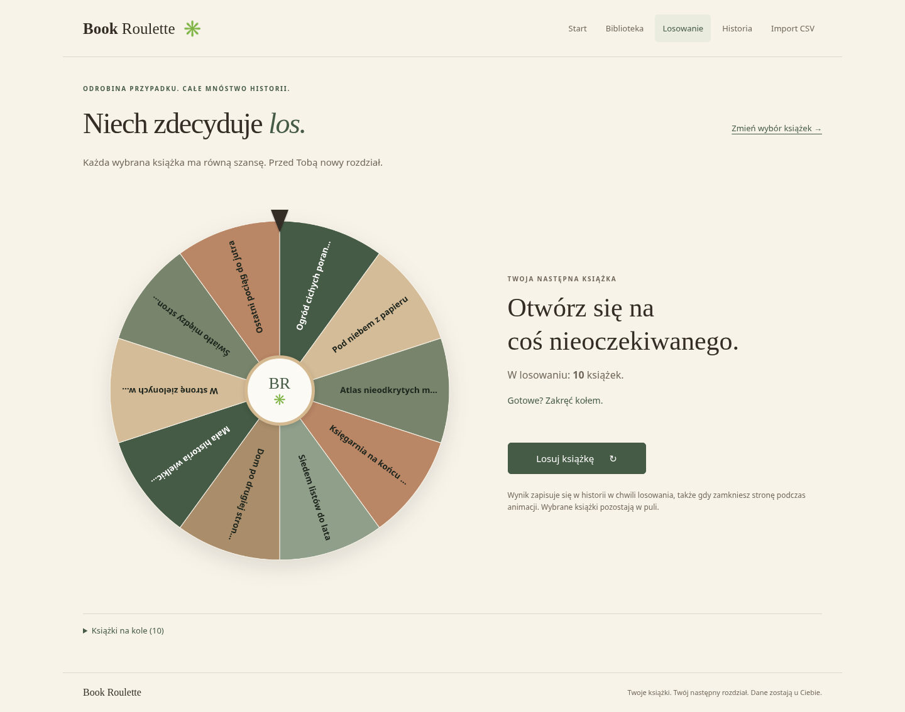

<div align="center">

# 📚 Book Roulette

### Twoja biblioteka. Odrobina przypadku. Następny wielki rozdział.

Prywatna aplikacja do losowania książek z Twojej biblioteki Goodreads.<br>
Ciepły interfejs po polsku, prawdziwe koło fortuny i dane przechowywane lokalnie.

[](https://github.com/Yorick0499/book-roulette/actions/workflows/tests.yml)
[](https://www.python.org/)
[](https://flask.palletsprojects.com/)
[](https://sqlite.org/)
[](LICENSE)

[Start w 3 minuty](#szybki-start) · [Skąd wziąć książki?](#skąd-wziąć-książki) · [iPhone i LAN](#iphone-i-sieć-lan) · [Testy](#testy)



<sub>Zrzut działającej aplikacji. Wszystkie widoczne tytuły i autorzy pochodzą z fikcyjnego zestawu demo.</sub>

</div>

## Co potrafi aplikacja

- **Import Goodreads CSV** — Unicode, ISBN, oceny, półki, duplikaty i podsumowanie. Ponowny import aktualizuje metadane, zachowując lokalny wybór i historię.
- **Twoja biblioteka** — wyszukiwanie po tytule i autorze, filtry półek, sortowanie, stronicowanie, wybór pojedynczych książek i całej widocznej strony.
- **Animowane koło** — równe szanse dla każdej zaznaczonej książki; serwer losuje wynik, a animacja zatrzymuje się na właściwym segmencie.
- **Wynik i historia** — tytuł, autor, półka, ponowne losowanie oraz link Goodreads, jeśli książka posiada poprawny identyfikator.
- **Trwałe dane** — książki, wybór, filtry i historia pozostają po odświeżeniu oraz restarcie.
- **Telefon i komputer** — responsywny interfejs, obsługa klawiatury i ograniczonych animacji.
- **Działanie offline** — bez konta w usłudze, API, CDN, Dockera i telemetrii. Instalacja zależności wymaga internetu; późniejsza praca z biblioteką już nie.

Okładki mają autorski wygląd typograficzny. Aplikacja nie pobiera ilustracji z Goodreads ani Open Library; metadane książek nie opuszczają Twojego serwera. Linki zewnętrzne otwierasz świadomie.

## Szybki start

Wymagany **Python 3.12+**, Git, pip i moduł `venv`. Środowisko docelowe: Ubuntu 24.04 LTS.
Jeśli brakuje modułu `venv`, przygotuj pakiet systemowy `python3-venv` przed instalacją.

```bash
git clone https://github.com/Yorick0499/book-roulette.git
cd book-roulette
python3 -m venv .venv
.venv/bin/python -m pip install -r requirements.txt
.venv/bin/python -m book_roulette
```

Otwórz **http://127.0.0.1:8080**. Zatrzymanie: `Ctrl+C`. Inny port: `--port 8090`.

### Chcę od razu sprawdzić pełne działanie

```bash
.venv/bin/python -m book_roulette --demo
```

Tryb demo wczytuje [12 fikcyjnych książek z CSV](examples/library-demo.csv) do **oddzielnej bazy** `instance/demo.sqlite3`.
Przejdź do **Biblioteka → Zaznacz tę stronę → Losuj książkę**. Domyślnie zobaczysz 10 książek na półce `to-read`; filtr „Wszystkie półki” pokazuje wszystkie 12.

Uruchomienie bez `--demo` wraca do własnej bazy `instance/library.sqlite3`. Dane demo nie są automatycznie dodawane do własnej biblioteki. W pustej bibliotece dostępny jest też jawny przycisk wczytania demo do aktualnie używanej bazy; nie zastępuje ani nie usuwa istniejących danych.

## Skąd wziąć książki?

**`git clone` dostarcza aplikację i publiczny CSV demonstracyjny, ale nie Twoją prywatną bibliotekę ani katalog wszystkich książek Goodreads.**

Goodreads nie wydaje nowych kluczy do publicznego API od grudnia 2020 r. Projekt nie obiecuje automatycznej synchronizacji, nie używa scrapingu ani prywatnych endpointów. Własną bibliotekę przeniesiesz przez oficjalny eksport:

1. Zaloguj się do Goodreads w swojej przeglądarce.
2. Wybierz **My Books → Import and Export → Export Library**.
3. Pobierz plik `goodreads_library_export.csv` na swój komputer.
4. Uruchom aplikację **bez `--demo`**, wybierz **Import CSV** i prześlij eksport.
5. W bibliotece wybierz półkę i zaznacz książki do losowania.

Możesz też zasilić bazę od razu przy uruchamianiu:

```bash
.venv/bin/python -m book_roulette --import-csv ~/Downloads/goodreads_library_export.csv
```

Plik pozostaje w swoim prywatnym katalogu; aplikacja nie kopiuje go do repozytorium. Kolejne uruchomienie tej komendy bezpiecznie aktualizuje metadane. `--import-csv` nie łączy się z `--demo`.

Eksport zawiera książki z Twoich półek, a nie wszystkie książki serwisu. Nie potrzebujesz podawać aplikacji loginu, hasła ani tokenu Goodreads. Późniejsze zmiany półek przeniesiesz, eksportując i importując plik ponownie.

### Zasady importu

| Obszar | Zachowanie |
| --- | --- |
| Format | CSV rozdzielany przecinkami, UTF-8, także z BOM |
| Wymagane nagłówki | `Book Id`, `Title`, `Author` |
| Pozostałe pola | Dodatkowi autorzy, ISBN/ISBN13, oceny, półki, daty; brakujące wartości są dozwolone |
| Limity | 10 MB całego żądania, do 50 000 wierszy |
| Duplikaty w pliku | Pierwszy poprawny wiersz danego Book Id wygrywa |
| Ponowny import | Aktualizacja po identyfikatorze Goodreads, bez zmiany lokalnego wyboru |
| Pomijane wiersze | Brak liczbowego ID, pusty tytuł, nieprawidłowa ocena lub powtórzony ID |
| Uszkodzony CSV | Cały import odrzucony bez częściowego zapisu |
| Brak książki w nowym eksporcie | Lokalna książka pozostaje w bazie |
| Plik na serwerze | Przetwarzany w pamięci, nie jest zachowywany |

CSV demo jest osobnym źródłem danych, bez identyfikatorów Goodreads. Wczytuje go przycisk demo lub `--demo`, a nie formularz importu Goodreads.

## Jak działa losowanie

1. Serwer pobiera aktualny zestaw zaznaczonych książek.
2. `secrets.randbelow(n)` wybiera równomiernie indeks zwycięzcy.
3. Wynik i migawka tytułu/autora zapisują się w SQLite w jednej transakcji.
4. Przeglądarka rysuje dokładnie ten zestaw i obraca koło do środka zwycięskiego segmentu.
5. Po wyhamowaniu pokazuje wynik. Przy `prefers-reduced-motion` pomija obrót.

Liczba klatek i długość animacji nie wpływają na wynik. Dla dużych zestawów koło pokazuje numery części segmentów; pełna numerowana lista jest pod kołem. Zaznaczone książki pozostają w puli po losowaniu.

Historia zapisuje się **przed animacją**, więc zamknięcie karty nie usuwa wyniku. Ponowienie tego samego żądania po utracie odpowiedzi nie tworzy kolejnego wpisu; pamiętanych jest ostatnich 100 kluczy ponowień. Sama historia pozostaje bez tego limitu. Biblioteka i ustawienia są wspólne dla wszystkich urządzeń korzystających z tej instancji.

## iPhone i sieć LAN

Domyślnie serwer nasłuchuje wyłącznie na localhost. Aby świadomie udostępnić go w domowej sieci:

```bash
.venv/bin/python -m book_roulette --lan --port 8080
```

1. Połącz laptop i iPhone z tą samą zaufaną siecią Wi-Fi.
2. Sprawdź adres LAN laptopa, np. `hostname -I` — wybierz adres interfejsu Wi-Fi, zwykle `192.168.x.x`.
3. W Safari otwórz `http://ADRES_IP_LAPTOPA:8080`.
4. Pozostaw laptop włączony z uruchomionym serwerem.

Serwer **Waitress** działa bez debuggera; program nie uruchamia serwera deweloperskiego Flask i nie zmienia UFW. Izolacja urządzeń w sieci gościnnej lub zapora mogą blokować dostęp. Nie przekierowuj portu na routerze i nie wystawiaj aplikacji w internecie.

**Tryb LAN nie ma logowania ani szyfrowania HTTP.** Osoby z dostępem do portu mogą odczytywać bibliotekę i zmieniać jej stan. CSRF nie zastępuje uwierzytelniania. Korzystaj z localhost lub zaufanej sieci; projekt nie jest usługą do publicznego hostingu.

Interfejs jest przetestowany w Chromium przy szerokościach **375, 390, 430, 768 i 1440 px**. Nie przeprowadzono testów na fizycznym iPhonie ani w Safari; aplikacja nie wymaga instalacji jako PWA.

## Prywatność i publiczne repozytorium

Publiczny jest **kod i fikcyjny zestaw demonstracyjny**, nie lokalna biblioteka.

- `.gitignore` wyklucza `instance/`, bazy SQLite, prywatne CSV, `.env`, klucze, logi i kopie zapasowe.
- Jedyny wyjątek CSV to jawny, sprawdzony `examples/library-demo.csv`.
- Klucz podpisujący sesję powstaje lokalnie w `instance/session.key`, z uprawnieniami `0600`. Nie jest wpisany w kod ani wysyłany do Git.
- Cookies zawierają token CSRF i liczbowe podsumowanie importu, bez książek.
- Operacje zapisu wymagają CSRF. Zapytania SQL są parametryzowane, sortowanie korzysta z zamkniętej listy, a HTML książek jest escapowany.
- Nagłówki CSP, `nosniff`, `no-referrer` i `no-store` ograniczają osadzanie strony, zewnętrzne zasoby i cache prywatnych odpowiedzi.
- Przed commitem zawsze sprawdź `git diff --cached`. `.gitignore` nie usuwa plików, które zostały już wcześniej dodane do Git.

Nie dołączaj prawdziwych eksportów ani zrzutów prywatnej biblioteki do zgłoszeń błędów. Jeśli sekret trafi do historii Git, samo usunięcie pliku nie wystarczy — unieważnij sekret i usuń go z historii.

### Dane i kopia zapasowa

| Plik | Zawartość |
| --- | --- |
| `instance/library.sqlite3` | Własne książki, zaznaczenie, ustawienia i historia |
| `instance/demo.sqlite3` | Oddzielna biblioteka trybu `--demo` |
| `instance/session.key` | Prywatny, generowany lokalnie klucz sesji |

Aby wykonać kopię, **zatrzymaj serwer** i skopiuj katalog `instance/` w prywatne miejsce poza repozytorium. Aby odtworzyć dane, zatrzymaj serwer i przywróć kopię do tego samego katalogu. Nie usuwaj własnej bazy przy aktualizacji kodu. Inicjalizacja tworzy brakujące tabele bez kasowania istniejących danych; przyszłe zmiany kolumn będą wymagały migracji.

## Architektura

```text
book_roulette/
├── __init__.py       # konfiguracja, nagłówki bezpieczeństwa, fabryka aplikacji
├── __main__.py       # CLI: localhost / LAN / demo, Waitress
├── db.py             # połączenia SQLite i inicjalizacja
├── schema.sql        # książki, ustawienia, historia, klucze ponowień
├── importer.py       # adapter Goodreads CSV i oddzielne źródło demo
├── library.py        # wyszukiwanie, półki, stronicowanie i preferencje
├── security.py       # ochrona CSRF
├── views.py          # widoki i API losowania
├── templates/        # Jinja2
└── static/           # lokalny CSS, Vanilla JS i matematyka koła
examples/             # wyłącznie fikcyjny CSV demonstracyjny
tests/                # testy backendu, geometrii i przeglądarki
```

Lokalne `books.id` i opcjonalne `goodreads_id` są osobnymi polami. Nowe źródła danych można dodać jako adapter importera bez zmiany algorytmu losowania. Dane demo nie dostają fikcyjnych identyfikatorów Goodreads.

## Testy

Backend — Python, bez dodatkowych zależności testowych:

```bash
.venv/bin/python -m unittest discover -s tests -v
```

Geometria koła — opcjonalny Node.js 24, bez pakietów npm:

```bash
node tests/wheel-math.test.cjs
```

Pełny test w przeglądarce — opcjonalny Playwright:

```bash
.venv/bin/python -m pip install -r requirements-dev.txt
.venv/bin/python -m playwright install chromium
.venv/bin/python tests/browser_smoke.py
```

Jeśli masz systemowe Chromium, zamiast pobierania przeglądarki możesz wskazać `BROWSER_EXECUTABLE=/usr/bin/chromium`. Test przeglądarkowy sam uruchamia lokalny serwer i używa **tymczasowej bazy**, nigdy Twojej biblioteki. Zrzut do dokumentacji generujesz opcją `SCREENSHOT_PATH=docs/screenshot.png`.

Testy obejmują import, duplikaty, błędne CSV, trwałość danych, CSRF, limit pliku, Unicode/XSS, filtry, zaznaczenie, współbieżne ponowienia losowania oraz 0, 1, 2, 10 i 100 książek. Test matematyczny sprawdza każdy indeks także dla 1 000 i 50 000 segmentów. Test przeglądarkowy przechodzi pełną ścieżkę demo → wybór → wyszukiwanie → koło → wynik → historia → import i weryfikuje wskazany segment przy zwykłej oraz ograniczonej animacji.

CI uruchamia testy backendu na Pythonie 3.12 i 3.13, test geometrii oraz oddzielny test przeglądarkowy. Badge na górze pokazuje rzeczywisty stan GitHub Actions, bez wpisywania wyniku na sztywno.

## Rozwój projektu

Znalazłeś błąd lub chcesz pomóc? Zobacz [CONTRIBUTING.md](CONTRIBUTING.md). Do zgłoszeń dołączaj wyłącznie zanonimizowane lub fikcyjne przykłady. Repozytorium nie jest powiązane z Goodreads ani przez nie sponsorowane.

## Licencja

Kod udostępniony na licencji [MIT](LICENSE). Nazwy Goodreads i pozostałych usług należą do ich właścicieli. Twoje lokalne dane pozostają Twoje.
